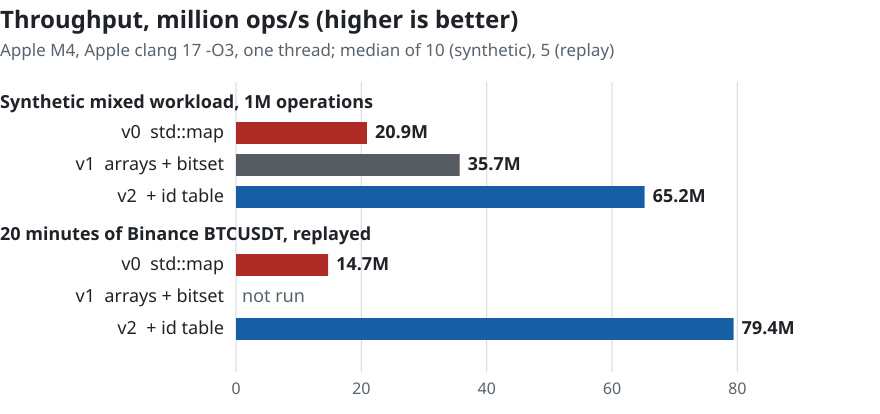

# lob-engine

A limit order book and matching engine in C++20. Two measured steps took the mixed workload from **20.9M to 65.2M ops/s (3.1×)**: flat price-level arrays with a bitset (v1), then an open-addressing id table in place of `std::unordered_map` (v2). On 20 minutes of real Binance BTCUSDT order flow, v2 is 5.4× faster than the `std::map` version, but the replayed book peaks at 4,203 live orders and fits in cache. The same tests check every version; 16 bugs were planted to test them, and the tests caught all 16.

<picture><source media="(prefers-color-scheme: dark)" srcset="docs/throughput-dark.svg"></picture>

```bash
cmake -S . -B build -DCMAKE_BUILD_TYPE=Release && cmake --build build -j
./build/lob_tests && ./build/lob_bench && ./build/lob_latency
```

## Results

Apple M4, macOS 26, Apple clang 17, `-O3`, one thread, median of 10 interleaved repetitions. Synthetic workload with a fixed seed: 55% limit adds within ±50 ticks of mid (10% of them crossing), 40% cancels, 5% market orders. It peaks at about 109k live orders. In the two mixed-workload rows all three versions are sized for 262,144 orders; the passive-add, add + cancel and sparse-book benchmarks size their own books. v0 (`MapOrderBook`) and the current book are both in this repo, and `lob_bench` runs them side by side; their columns are from [`bench/results/2026-10-30-m4-b3e2236/`](bench/results/2026-10-30-m4-b3e2236/) (commit `2265115`). v1 is on the [`v1-random`](https://github.com/aayxshkumar/lob-engine/tree/v1-random) branch, the v1 book from `536cb05` with the random-id workload and the current harness added, and its column is from [`bench/results/2026-10-29-m4-d512779/`](https://github.com/aayxshkumar/lob-engine/tree/103a6b0/bench/results/2026-10-29-m4-d512779) there (commit `103a6b0`). `tools/run_bench.sh` writes these folders, raw JSON included.

The machine wasn't idle: each of the four runs from 29–30 October started at a load of 2.4 to 3.8, and where other processes were sampled, Spotlight indexing held about one core (`meta.txt` records the load, and `cpu.txt` in the main run samples what else was running). The ratios between versions are stable (v0 agrees within 1% across the two branches, and main's two runs agree within 2%), but the absolute figures may be a few percent low.

| Benchmark | v0 `std::map` | v1 arrays + bitset | v2 + id table | v0 → v2 |
|---|---|---|---|---|
| Mixed workload, 1M ops | 20.9M ops/s | 35.7M ops/s | **65.2M ops/s** | 3.1× |
| Same, random-looking order ids | 19.9M ops/s | 31.2M ops/s | **56.2M ops/s** | 2.8× |
| Passive adds, 100k | 35.1M ops/s | 38.7M ops/s | 160M ops/s | 4.6× |
| Add + cancel, warm book | 32.9 ns | 28.8 ns | **9.4 ns** | 3.5× |
| Sparse book, 1,000-tick gaps | 1.57 µs | 1.20 µs | 0.60 µs | 2.6× |

### v2: the id table, and the benchmark that flattered `std::unordered_map`

Every add, cancel and fill looks an order up by id. After v1, that lookup was the largest cost left: `std::unordered_map` allocates a node per order, and each lookup follows a bucket pointer and then a node pointer.

Before replacing it I made the benchmark harder. The generator handed out ids 1, 2, 3…, which is unusually kind to `unordered_map`: consecutive ids land in consecutive buckets, and nodes allocated in order sit next to each other in memory. A real feed rarely gives one book a dense 1, 2, 3 run: on Nasdaq ITCH, for example, order numbers are assigned across every instrument, so a single book sees a sparse, interleaved subset, and scrambled ids are the pessimistic version of that. Scrambling the same ids with a bijective mixer (the splitmix64 finaliser) costs v1 13% (35.7M → 31.2M ops/s) and v0 5% (20.9M → 19.9M). The v1 runs with scrambled ids are committed on the `v1-random` branch.

[`IdTable`](include/lob/id_table.hpp) is a flat array of 16-byte `{id, slot}` entries with linear probing, at most half full, using Fibonacci hashing (one multiply). Deletes use backward shift rather than tombstones, so a long-running book doesn't fill up with dead entries. Its capacity is fixed by the order pool, so it never rehashes.

The catch is that a fixed table's memory follows the configured capacity, not the live order count. Sized for 1M orders it's 32 MB, which doesn't fit in cache, and with sequential ids the gain disappears (v1 35.5M, v2 36.0M). Sized to the workload (262,144 orders: 2^19 slots, 8 MB) it's about 1.8× v1 on both kinds of id (65.2M against 35.7M, 56.2M against 31.2M); scrambled ids cost v2 about as much as v1, 14%. So size the book for the peak you expect, not the largest number you can think of.

### v1: the step that made it worse first

Flat arrays alone weren't a clear win. When the best level empties, the next one has to be found, and the first v1 walked the array one level at a time. The sparse-book benchmark exposed two problems with that. These figures are from the earlier harness, which also timed a pause and resume of the benchmark timer (about 0.4 µs) and the book's teardown, so they aren't comparable with the Results table:

| Sparse sweep (50 levels), earlier harness | v0 map | v1 array, linear scan | v1 + bitset |
|---|---|---|---|
| gap 1 tick | 2.0 µs | 22.5 µs → 1.5 µs* | 1.5 µs |
| gap 100 ticks | 2.0 µs | 3.0 µs | 1.6 µs |
| gap 1,000 ticks | 2.0 µs | 14.8 µs | **1.85 µs** |

\* The 22.5 µs was a bug, not the gap. When the last ask was cleared, the scan walked the whole 65,536-level price band looking for an ask that didn't exist. The level count already knew the side was empty; now it says so and skips the scan.

The fix for real gaps is one bit per price level. Finding the next non-empty level then checks 64 levels per instruction (`std::countr_zero`), which beats following `std::map` pointers even with 1,000 empty ticks between levels. The current harness times only the sweep (`b3e2236`): at 1, 100 and 1,000-tick gaps the bitset build takes 0.90, 0.98 and 1.20 µs against 1.56, 1.56 and 1.57 µs for the map.

### Latency percentiles: read with care

On Apple Silicon `steady_clock` ticks every ~41.7 ns, so every sample below is a whole number of ticks; the tool detects this and says so. Treat these as tick counts. Precise nanosecond percentiles will come from Linux runs.

| `lob_latency`, 1M ops | v0 p99 | v2 p99 | v0 p99.9 | v2 p99.9 |
|---|---|---|---|---|
| add_limit | 2 ticks | 2 ticks | 14 ticks | **3 ticks** |
| cancel | 3 ticks | **2 ticks** | 6 ticks | **3 ticks** |

The CDFs are in [`docs/`](docs), plotted from [`m4-quantiles.csv`](docs/m4-quantiles.csv) by `tools/plot_cdf.py`.

## On real data: 20 minutes of Binance BTCUSDT

[`tools/record_binance.py`](tools/record_binance.py) records Binance's public depth-diff and trade streams using only the Python standard library. It follows Binance's procedure for keeping a local book (buffer the diffs, take a REST snapshot, drop what the snapshot already covers), and it stops on any sequence gap rather than record a book that disagrees with the exchange.

Binance publishes price levels, not individual orders, so [`lob_replay`](bench/replay.cpp) translates the recording into order operations:

- a level that grows gets a new resting order for the difference;
- a level that shrinks loses size from its newest orders first;
- a trade becomes a taker order at the trade price, so it fills the oldest orders, and any remainder is cancelled;
- within one diff message, reductions are applied before additions.

After every diff message it compares the book's top 10 levels on each side with the exchange's.

Recorded on 29 October 2026, 02:30–02:50 UTC: 11,992 diff messages (544,092 level updates) and 71,328 trades. The 65,536-tick price band (±$327 around $79,900) skipped 44,015 updates to levels further out.

| Replay | |
|---|---|
| Order operations | 562,850: 53.5% adds, 40.3% cancels, 6.2% size reductions |
| Peak resting orders | 4,203 |
| Top 10 levels match the exchange | after 99.93% of diff messages (100% with trades left out) |
| v0 `std::map`, median of 5 | 14.7M ops/s |
| v2, median of 5 | **79.4M ops/s (5.4×)** |

The 0.07% comes from the two streams, not the book. Binance doesn't sequence trades against depth diffs, so a trade can arrive after the diff that already includes it, and the book takes that size twice until the next diff for the level corrects it. Replaying the same recording without trades matches after every message.

The replay figures are from [`replay.txt`](bench/results/2026-10-30-m4-b3e2236/replay.txt) in the same run as the Results table. v1 wasn't run on the replay.

Caveats: the order ids are invented, queue positions are inferred from level sizes, and a book of 4,203 orders fits in cache, so this says little about a much deeper book. Recordings aren't committed (`data/` is git-ignored). To make your own:

```bash
python3 tools/record_binance.py BTCUSDT 1200 data/btcusdt.lobrec
./build/lob_replay data/btcusdt.lobrec
```

## Correctness

- **Every test runs against both books.** The test suites are typed: the same 22 tests run on `OrderBook` and `MapOrderBook`, plus 3 tests specific to the array (price-band edges, out-of-range rejection, finding the next best price across gaps) and 4 for the id table. 51 tests in total.
- **Differential test:** 20,000 random operations (adds, cancels, three kinds of modify, market orders) per seed, 10 seeds, go through each book and a deliberately naive [`ReferenceBook`](tests/reference_book.hpp). After every step the trades, best bid and ask, order count and depth at every reachable price must match exactly.
- **Id table differential test:** 20 seeds × 20,000 inserts and erases against `std::unordered_map`, in a 16-entry table so probe runs are long and wrap past the end of the array, which is where backward-shift bugs hide.
- **Mutation-checked:** 16 bugs were planted and the tests caught all 16.
  - Matching rules: priority kept on a size increase, market orders obeying a limit, trades at the taker's price, crossing one tick early, a stale level total.
  - Array book: a skipped rescan (it hangs, which the run's time limit catches), a rescan that skips a level, a new best bid ignored, a level count that never drops.
  - Bitset: a mask off by one, a search starting one level too far, a bit never cleared.
  - Id table: erase without the backward shift, a shift that ignores wrap-around, an off-by-one in the "can this entry stay" test, a shift that stops after one move. (A fifth mutant survived, but it was equivalent: swapping the empty check and the key check can't change the result, because an empty entry's value is already the "absent" marker.)
- **Replay check:** `lob_replay --strict` replays a synthetic recording (`tools/make_test_recording.py`) and fails unless both books end identical and the top 10 levels per side match the recording after every message. It caught a real translation bug: a message that clears an ask and adds a bid at the same price must apply the reduction first, or the bid crosses the stale ask and invents a trade.
- **CI:** three jobs run the tests and the strict replay: Clang on Ubuntu as a release build without sanitizers (plus a short latency run), GCC on Ubuntu under AddressSanitizer and UndefinedBehaviorSanitizer, and Clang on macOS under UndefinedBehaviorSanitizer.

## Design

| Piece | Choice | Why |
|---|---|---|
| Price levels | Two flat arrays (bids, asks) indexed by tick offset | Real exchanges enforce price bands. Indexing is one subtraction, with no tree to walk |
| Next best level | A bitset of non-empty levels, scanned with `countr_zero` / `countl_zero` | Checks 64 levels per step, so sparse books stay fast |
| Orders | Pre-allocated pool, intrusive doubly linked list per level | No allocation per order, and O(1) cancel |
| id → order | Open addressing, linear probing, ≤50% load, backward-shift delete | One hash and usually one cache line, with no allocation per order. Memory is fixed by capacity |
| Trades | Appended to a caller-owned vector | No allocation once it has warmed up |

Trade-offs: a 65,536-tick price band costs about 1.5 MB of level arrays per book, and prices outside the band are rejected (`Result::PriceOutOfRange`). Not handled yet: self-trade prevention, IOC/FOK, multiple instruments.

## Roadmap

- [x] Order book core, typed tests, differential test, mutation checks, CI
- [x] **v1:** flat price-level arrays + bitset (1.7× on the mixed workload)
- [x] **v2:** open-addressing id table (1.8× over v1 on the mixed workload)
- [x] Binance depth feed: record to binary, replay through the book (5.4× over v0 on 20 minutes of BTCUSDT, a book small enough to fit in cache)
- [ ] Linux runs with a TSC-based timer for nanosecond percentiles, plus `perf stat` cache-miss numbers
- [ ] SPSC ring buffer between feed and engine threads, with ThreadSanitizer in CI and `rigtorp/SPSCQueue` as the baseline
- [ ] Market-making strategy on replayed data

## Layout

```
include/lob/   order_book.hpp, id_table.hpp, map_order_book.hpp (v0 baseline), types.hpp
src/           implementations
tests/         typed GoogleTest suites, reference_book.hpp (test oracle)
bench/         workload generator, throughput benchmarks, latency percentiles, replay
bench/results/ raw output of tools/run_bench.sh, one folder per run (commit, machine, JSON)
tools/         record_binance.py (stdlib-only recorder), make_test_recording.py, run_bench.sh,
               plot_cdf.py, plot_throughput.py and plot_depth.py (the images in docs/)
```

## How it was built

I directed this project and built it with Claude Code. Every commit carries a `Co-Authored-By: Claude` trailer. How I use it is on my [colophon](https://aayxshkumar.github.io/colophon.html#ai).

MIT licensed.
